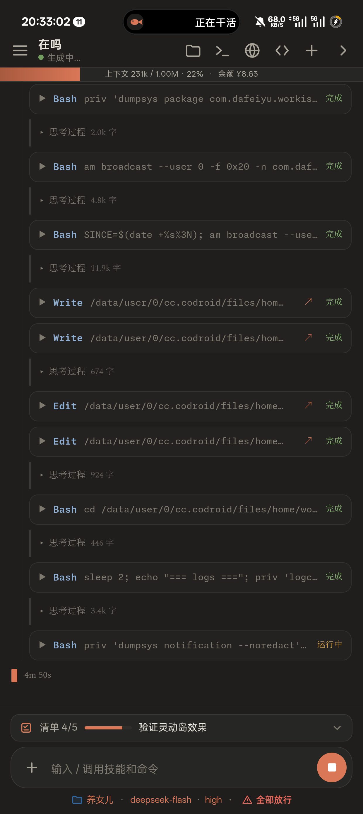
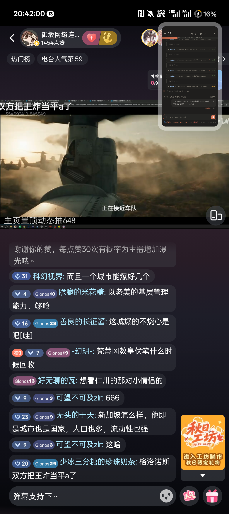
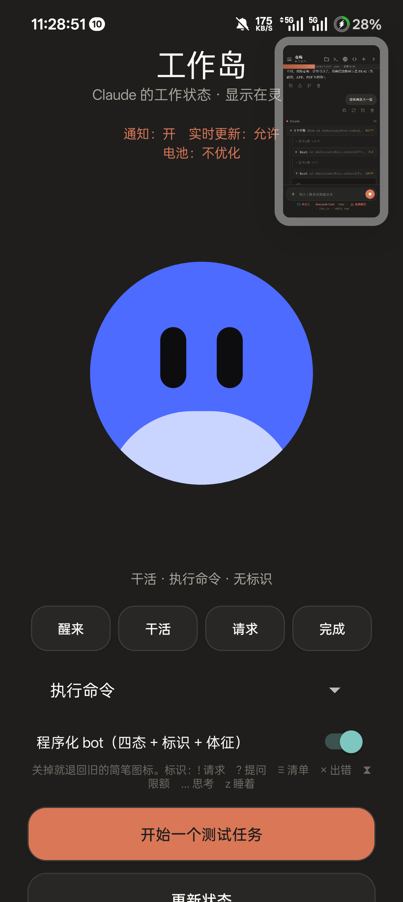
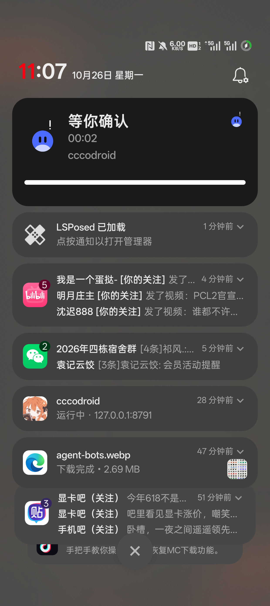

# 工作岛 · WorkIsland

> **测试状态：Pre-release / Alpha**
> 目前**只在 OnePlus PJA110 · ColorOS 16.0.3 · Android 16（SDK 36）· cccodroid 0.4.2–0.4.6** 上测试成功。
> 其他 ColorOS 版本、其他品牌机型均未验证；接口与文件布局可能继续变动，不建议用于生产或关键任务。
> 详细边界见 [`STATUS.md`](STATUS.md)。

把 **cccodroid 里 Claude 的实时工作状态**，投到 **ColorOS 16 的流体云 / 灵动岛**上。

- 干活时：胶囊标题跟着动作走——读文件 / 执行命令 / 思考中 / 等你确认；下面跟着更细的描述
- `TodoWrite` 任务清单会显示「清单 x/y」
- 收工：写「任务完成」+ 用时
- 8 秒后：岛上收起，通知栏只留一条安静的「工作岛 · 在后台等下一轮」
- **四态 bot**：Wakes / Works / Asks / Done；14 种 look、7 个头顶标识（`! ? ≡ × ⧗ … z`）
- **21 个模型**：每个 agent 有自己的形状、配色、眼睛，Claude 有手脚、DeepSeek 有肚子、Grok 有环、Cursor 缺一角、OpenClaw 有触须
- **可关**：设置里的「程序化 bot」开关关掉就退回旧的简笔图标
- **岛上不空**：折叠胶囊显示「思考中 1/4」这种状态 + 清单进度；展开后有计时、副标题和分段进度条
- **会动**：思考时头顶省略号逐帧跳、眼睛左右瞟、身体轻浮；每轮开始有 0.4 秒 logo→bot 的唤醒

不是另开一个任务清单，也不是模拟动画——数据直接来自 cccodroid 网关的真实事件流。

| 正在干活 | 任务完成 | 8 秒后收起 |
|---|---|---|
|  |  |  |

| 四态 bot（应用内预览） | 21 个模型 / 14 个 look | 通知里也带上标识 | 思考时的胶囊 |
|---|---|---|---|
|  |  |  |  |

更多截图见 `screenshots/`（含四态 bot、模型对照、岛上 `!` 标识、图标选择器），完整边界见 [`STATUS.md`](STATUS.md)，方案见 [`docs/01-方案与设计.md`](docs/01-方案与设计.md)。

**下载**：[Release 页面](https://github.com/STUTTEFRFIX/WorkIsland-Android/releases) · 1.4 的 APK 与 PDF 也在本仓库 `apk/`、`pdf/` 里。

---

## 交付物

| 路径 | 内容 |
|---|---|
| `apk/WorkIsland.apk` | 可直接安装的 APK（`com.dafeiyu.workisland`，versionName 1.4） |
| `source/app/` | Android 16 Live Update 应用源码（Java + 资源 + 构建脚本） |
| `source/driver/driver.mjs` | 独立状态驱动：0.4.2–0.4.6 的部署方式 |
| `source/gateway/work-island.mjs` | 0.4.2–0.4.6 的网关模块（spawn 独立 driver） |
| `source/gateway/server.mjs` | 0.4.2–0.4.6 已接入的网关入口（原文件见 `server.mjs.original`） |
| `source/upstream-pr/` | 上游 PR #21 合并版 + #22 跟进（网关内订阅 / 清单 / state / 单测 19 条） |
| `source/upstream-pr-review.patch` | 上游 PR #21 的完整 diff |
| `source/upstream-pr-review-22.patch` | 上游 PR #22（OPEN）的完整 diff |
| `screenshots/` | 工作态、完成态、收起、后台存活、应用界面截图 |
| `docs/` | 方案与设计、开发部署、测试报告、提交说明、开发过程与真机测试、状态与保活、厂商适配 |

APK 校验：

```
SHA-256  270d7684ad5ee7d9d70fb4604c3b5135776c53c1d408bd96928f3c2e619eb5c1
大小     342,761 字节
```

---

## 快速开始

1. 安装 `apk/WorkIsland.apk`。
2. 打开「工作岛」，确认三行状态：
   - 通知：开
   - 实时更新：允许
   - 电池：不优化
3. 接入网关：
   - **ccc odroid 0.4.7+**：设置 → 工作岛（ColorOS 灵动岛）→ 打开，重启一次网关。
   - **0.4.2–0.4.6**：按 `docs/02-开发与部署.md` 第 4 节接入独立 driver。
4. 在 cccodroid 里让 Claude 干一次活，看岛。

---

## 测试环境

| 项 | 值 |
|---|---|
| 设备 | OnePlus PJA110 |
| 系统 | ColorOS 16.0.3（Android 16 / SDK 36） |
| cccodroid | 0.4.2 |
| 网关 | 127.0.0.1:8791 |
| 应用 | com.dafeiyu.workisland 1.4 |
| 构建 | aapt2 2.20-android-16 / d8 9.2.4 / apksigner 0.9 / javac 21 |
| 编译 SDK | Android 16 platform-36（android.jar） |

---

## 一句话设计

> **网关负责“知道”，模块负责“判断”，工作岛负责“画”。**
> 定时器和事件流不放在会被 ColorOS 冻结的应用里，放在网关进程里。

0.4.7 起上游改为进程内订阅（`onPublish` + `runList`），不再单独起 driver；本仓库的 `source/driver/` 是 0.4.2–0.4.6 的部署方式。两种方式发送给同一个应用。

详细设计见 [`docs/01-方案与设计.md`](docs/01-方案与设计.md)。

---

## 参考与致谢

- [jazzenchen/agent-hud-open](https://github.com/jazzenchen/agent-hud-open)
  （Apache-2.0）：四态 bot、14 look、7 个标识、BotSpec 与渲染几何的移植来源。
- [cccodroid](https://github.com/greyoak111/cccodroid)：网关事件流、终端与宿主能力。
- [LobeHub Icons](https://github.com/lobehub/lobe-icons)（MIT）：21 个模型图标；
  商标归各自所有者，非官方关联。

---

## 许可与第三方说明

本项目使用 **Apache-2.0**，见 [`LICENSE`](LICENSE)。

第三方图标与许可：Agent HUD 图标（Apache-2.0）、LobeHub 模型图标（MIT），
详见 [`THIRD_PARTY.md`](THIRD_PARTY.md) 与 [`LICENSES/`](LICENSES/)。

> 工作岛是**第三方应用的可选集成**：cccodroid 只负责把状态送出来，不包含也不负责本应用的功能。
